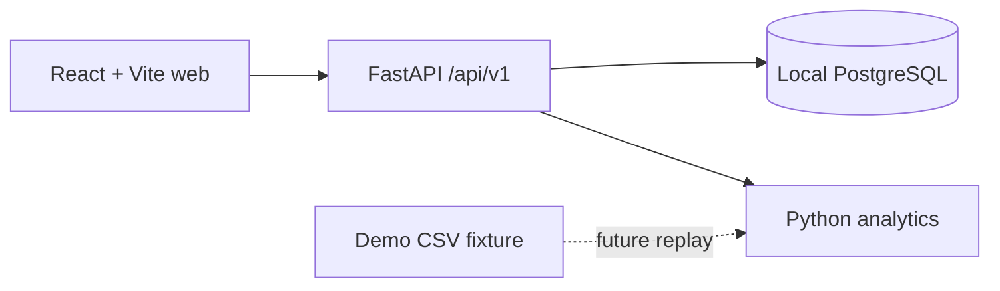

# GaitMate

GaitMate is a nonclinical research/demo application for ankle monitoring and
clinician-directed rehabilitation. It does not provide diagnosis, treatment advice,
or emergency response.

## Architecture



`apps/web` contains the React/TypeScript app, Tailwind styles, Radix-based accessible
button primitive, React Router, TanStack Query, and Recharts dependency.
`apps/api` contains the Python API and analytics module. `infra` holds local database
configuration, `fixtures` holds the original recording, and `legacy` archives the
prototype. There is no shared contracts package yet; the initial health schema is
small enough to maintain directly in both apps.

## Start

With Python 3.11+, Node 20.19+ or 22.12+, npm, and Docker Compose installed, run:

```sh
./scripts/bootstrap.sh
```

Open http://localhost:5173. See [development guidance](docs/DEVELOPMENT.md) for
checks, database lifecycle, and secret handling.

