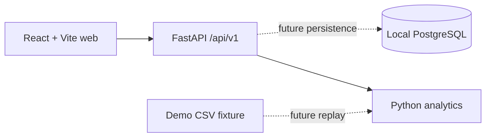

# GaitMate

GaitMate is a nonclinical research/demo application for ankle monitoring and
clinician-directed rehabilitation. It does not provide diagnosis, treatment advice,
or emergency response.

## Architecture



`apps/web` contains the React/TypeScript app, Tailwind styles, Radix-based accessible
button primitive, React Router, TanStack Query, and Recharts dependency.
`apps/api` contains the Python API and analytics module. `infra` holds local database
configuration, `fixtures` holds the original recording, and `legacy` archives the
prototype. There is no shared contracts package yet; the initial health schema is
small enough to maintain directly in both apps.

This foundation exposes a health endpoint and a research/demo landing page. The
database service is configured, but application tables, migrations, sign-in, and
patient workflows have not been implemented.

## Start

With Python 3.11+, Node 20.19+ or 22.12+, npm, and Docker Compose installed, run:

```sh
./scripts/bootstrap.sh
```

Open http://localhost:5173. See [development guidance](docs/DEVELOPMENT.md) for
checks, database lifecycle, and secret handling. Docker Compose starts only
PostgreSQL by default; the API container is available with `--profile api`.

## Commands

| Task | Command |
| --- | --- |
| Install and run local stack | `./scripts/bootstrap.sh` |
| Start database only | `docker compose -f infra/compose.yaml up -d --wait db` |
| Start database and container API | `docker compose -f infra/compose.yaml --profile api up -d --build --wait` |
| Stop containers | `docker compose -f infra/compose.yaml --profile api down` |
| Run local API | `.venv/bin/uvicorn gaitmate_api.main:app --reload --host 127.0.0.1 --port 8000` |
| Run local web app | `npm --prefix apps/web run dev` |
| Backend checks | `.venv/bin/ruff check apps/api && .venv/bin/ruff format --check apps/api && .venv/bin/mypy apps/api/src && .venv/bin/pytest apps/api/tests` |
| Frontend checks and build | `npm --prefix apps/web run lint && npm --prefix apps/web run format && npm --prefix apps/web run typecheck && npm --prefix apps/web test && npm --prefix apps/web run build` |

See [API conventions](docs/API_CONVENTIONS.md) for `/api/v1`, JSON responses,
errors, UTC timestamps, and request logging.

